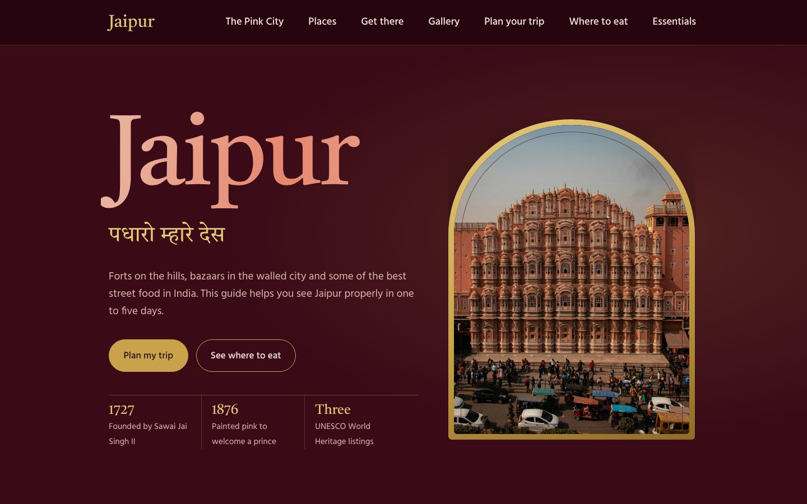
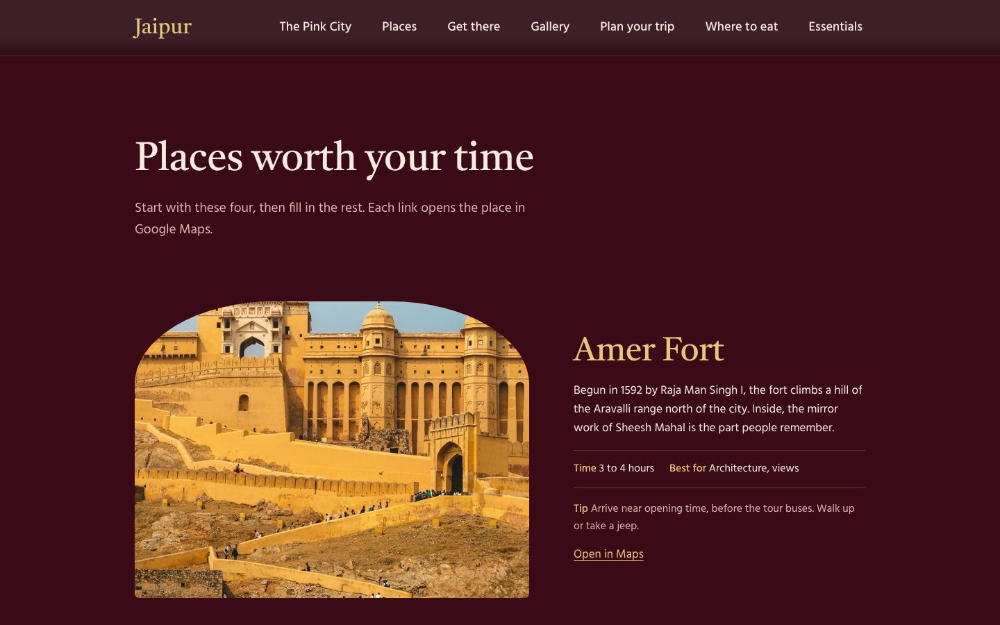
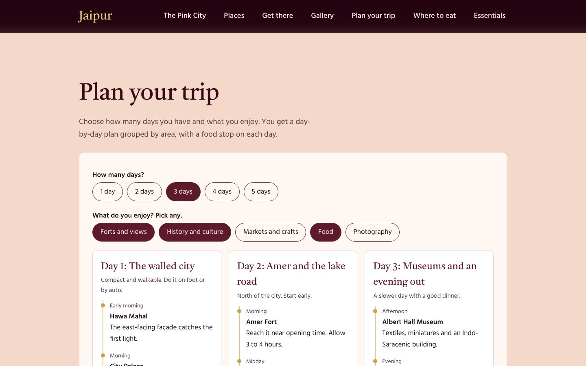
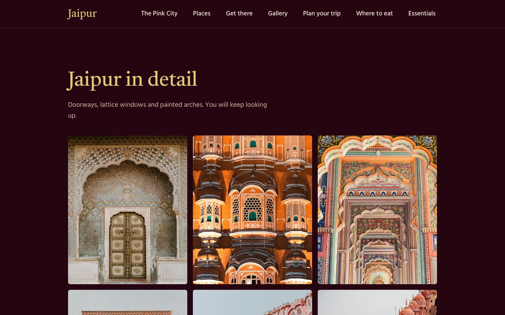

<div align="center">

# Jaipur, the Pink City

**A single-page tourist guide to Jaipur, built in a "Royal Heritage" style.**
Places, an interactive map, ways to get there, a day-by-day trip planner and a food guide with Google Maps links.

[**View the live site**](https://kodebyshubh.github.io/Tourist-site-Bhai/)




</div>

---

## What it does

A visitor lands on one page and can decide what to see, how to get there, what to eat and how to spend their days, without leaving the site.

| Section | What you get |
|---|---|
| **The Pink City** | Why the city is pink, told with a drag slider that repaints the old city from plain to pink, plus the three UNESCO listings (Jantar Mantar, Amer Fort and the hill forts, the walled city) |
| **Places** | Four feature stories (Amer Fort, Hawa Mahal, City Palace, Jal Mahal) plus compact cards for Jantar Mantar, Nahargarh, Jaigarh, Albert Hall, Johari Bazaar, Patrika Gate and more. Each has time needed, best for, a tip and an Open in Maps link |
| **Interactive map** | A Leaflet map with 10 numbered pins, a matching list, "Show all" and "Walled city" view buttons, and popups that link to Google Maps |
| **Get there** | Pick your home city and travel date. Links open Google Flights with Jaipur as the destination, plus the matching IRCTC route and RedBus |
| **Gallery** | 12 photos of doorways, windows and painted arches in a uniform grid |
| **Plan your trip** | Choose 1 to 5 days and your interests (forts, history, markets, food, photography). You get a day-by-day plan grouped by area, with a food stop each day, and a simple cost calculator |
| **Where to eat** | 14 well-known food stops (kachori, ghewar, lassi, chai, kulfi, thali) with what to try, a tip, category filters, and Open in Maps and Directions links |
| **Essentials** | A "Before you go" checklist (getting there, getting around, staying smart, what to buy) and a set of useful Hindi phrases you can tap to copy |

## Screenshots

<table>
  <tr>
    <td width="50%"><br><sub>Places, with time needed, tip and Maps link</sub></td>
    <td width="50%"><br><sub>Trip planner, grouped by area</sub></td>
  </tr>
  <tr>
    <td colspan="2"><br><sub>Gallery</sub></td>
  </tr>
</table>

## Design

- **Palette:** deep maroon, rose and gold, taken from the colours of the old city. Defined once as CSS variables at the top of the file.
- **Type:** Tiro Devanagari Hindi for headings (with a Hindi welcome line, *Padharo mhare des*) and Hind for body text.
- **Motion:** the hero title paints from white to Jaipur pink, sections fade in on scroll. Everything respects `prefers-reduced-motion`.
- **Accessibility:** skip link, keyboard-friendly controls, visible focus, labelled map region, and readable contrast on both dark and light sections.
- **Responsive:** layouts collapse from three columns to one on phones.

## Run it locally

No install, no build.

```bash
git clone https://github.com/kodebyshubh/Tourist-site-Bhai.git
cd Tourist-site-Bhai
```

Then open `index.html` in a browser. Fonts and map tiles load from the internet, so you need a connection for those. Leaflet itself is bundled in `vendor/leaflet/`, so the page does not depend on a CDN for scripts.

## Host it for free (GitHub Pages)

1. Push the repository to GitHub.
2. Go to **Settings > Pages**.
3. Under *Build and deployment*, choose **Deploy from a branch**, branch `main`, folder `/ (root)`, and save.
4. After a minute the site is live at `https://<your-username>.github.io/Tourist-site-Bhai/`.

## Project structure

```
.
├── index.html            the whole site: markup, styles and script
├── favicon.svg / .png / .ico
├── photos/               images, matched to the page by file name
│   ├── hero.jpg, hawa-mahal.jpg, amer-fort.jpg, ...
│   ├── g1.jpg to g12.jpg           gallery
│   └── food-*.jpg                  food cards
├── vendor/leaflet/       Leaflet 1.9.4 (JS, CSS, marker images)
└── docs/screenshots/     images used in this README
```

## How the photos are wired

Each image on the page is a slot, for example `data-slot="amer-fort"`. A small script looks for `photos/amer-fort.jpg` (or `.jpeg`, `.png`, `.webp`) and fills the slot. If a file is missing, the slot shows a lattice pattern instead, and food cards without a photo hide themselves. To change an image, replace the file with the same name. Keep each photo around 1600 px wide and under 400 KB so the page stays fast.

| Slots | Used for |
|---|---|
| `hero` | The arch window in the first screen |
| `hawa-mahal`, `amer-fort`, `city-palace`, `jal-mahal`, `jantar-mantar`, `nahargarh`, `jaigarh`, `albert-hall`, `bazaar`, `patrika-gate` | Place cards |
| `g1` to `g12` | Gallery |
| `food-kachori`, `food-sweets`, `food-lassi`, `food-chai`, `food-kulfi`, `food-street`, `food-paan`, `food-shrikhand`, `food-thali`, `food-puran`, `food-sampat`, `food-1135`, `food-sahu-chai` | Food cards |

## Built with

- HTML, CSS and vanilla JavaScript in a single file
- [Leaflet](https://leafletjs.com/) for the map, with Esri World Street Map tiles
- Google Maps, Google Flights, IRCTC and RedBus links for directions and travel
- [Google Fonts](https://fonts.google.com/): Hind and Tiro Devanagari Hindi

## Good to know

- Map pin positions are approximate. Use the Open in Maps links for exact locations.
- Train and bus links open the booking sites but cannot prefill the route, so the route is shown as text beside the button.
- Timings, prices and opening hours change. Check them before you travel.
- The restaurant list is a personal selection of well-known places, not a ranking.

## Credits

- **Photographs:** Unsplash (Abhishek R, Aditya Gunturu, Aditya Siva, Annie Spratt, Anshul Gurjar, Dewang Gupta, Dexter Fernandes, Giuliano Gabella, Abhinav, Harsh Jain, Meric Dagli, Mukul Saini, Satyam Bhardwaj, Vikas Pokar) and Pexels (Altaf Mughal, Ansh Yati, AXP Photography, Apratim Debnath, Urtimud 89). A few monument and food photos come from other public web sources and are used here for a non-commercial demo. Replace them before any commercial use.
- **Map:** Leaflet (BSD 2-Clause). Map tiles by Esri.
- **Fonts:** Hind and Tiro Devanagari Hindi (SIL Open Font License).

## Author

Built by **Shubh Bohra** as a take-home project.
[GitHub](https://github.com/kodebyshubh) · [LinkedIn](https://www.linkedin.com/in/shubh-bohra-056691293/) · [Portfolio](https://shubhbohra.me)
